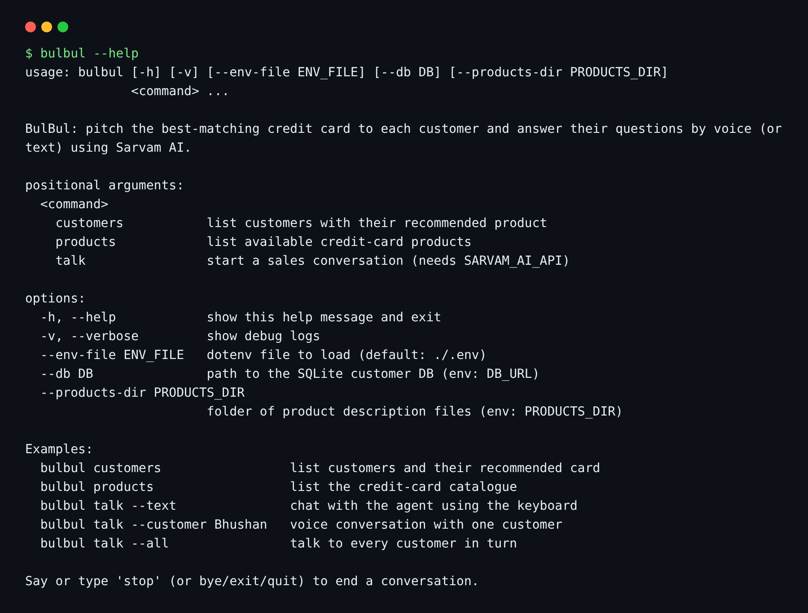
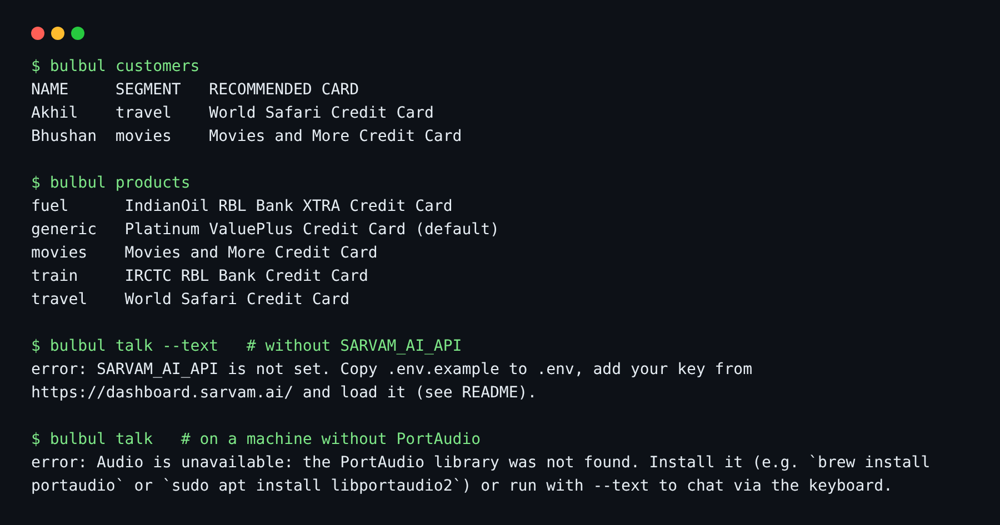
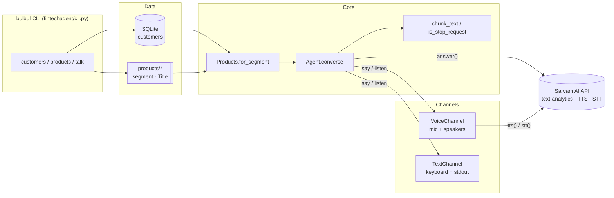
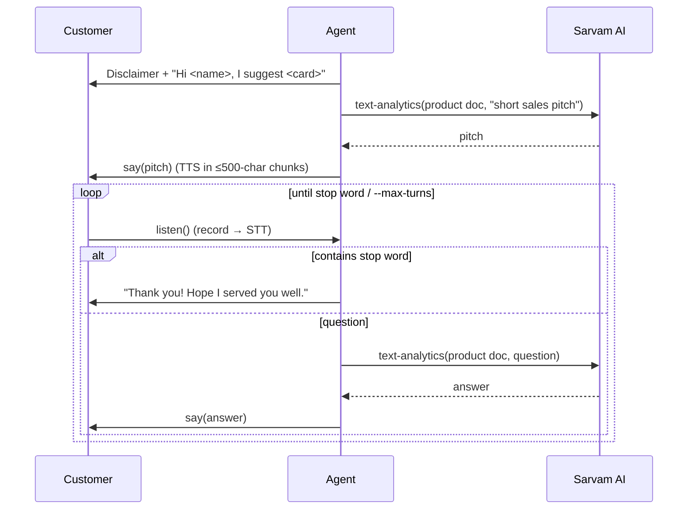

# BulBul: your fintech voice agent


> A command-line sales agent that picks the best-matching credit card for each customer, pitches it out loud, and answers follow-up questions in a free-flowing voice conversation, all powered by [Sarvam AI](https://www.sarvam.ai/).

BulBul was built for the **HydPy Hackathon 2025** (the slides are in [`HydPy Hackathon.pdf`](./HydPy%20Hackathon.pdf)). It shows how a bank could replace scripted tele-sales with an assistant that:

1. looks at a customer's **spending segment** (travel, movies, fuel, train, …),
2. matches it to a **credit-card product** from a plain-text catalogue,
3. generates a **short personalised pitch** with an LLM and reads it out with text-to-speech,
4. **listens** to the customer's questions (speech-to-text), answers them grounded in the product document, and
5. stops politely when the customer says **"stop"** (or *bye*, *close*, *exit*, *quit*).

It's aimed at developers exploring voice agents, Indian-language AI APIs, or retrieval-grounded sales and support bots.

> **Disclaimer:** this is a demo built for a tech event. The product texts are a bank's publicly available credit-card descriptions. It is not affiliated with or endorsed by that bank.

---

## Table of contents

- [Screenshots](#screenshots)
- [Features](#features)
- [Tech stack](#tech-stack)
- [Architecture](#architecture)
- [Project structure](#project-structure)
- [Getting started](#getting-started)
- [Configuration](#configuration)
- [Usage](#usage)
- [Commands and scripts](#commands-and-scripts)
- [Sarvam API endpoints used](#sarvam-api-endpoints-used)
- [Testing](#testing)
- [Linting, formatting and type checking](#linting-formatting-and-type-checking)
- [Deployment](#deployment)
- [Troubleshooting / FAQ](#troubleshooting--faq)
- [Known limitations and roadmap](#known-limitations-and-roadmap)
- [Contributing](#contributing)
- [License and credits](#license-and-credits)

---

## Screenshots

These are real terminal captures of the CLI, run against the seed database that ships with the migrations.

**`bulbul --help`**



**Offline commands and friendly error messages**



## Features

- 🎯 **Segment-based recommendation.** Each customer's segment is matched to a product file, falling back to the `generic` card.
- 🗣️ **Voice conversation loop.** The agent speaks a pitch, you reply into the microphone, and it answers using the product description as context.
- ⌨️ **Text mode (`--text`).** Chat from the keyboard with no microphone, speakers or PortAudio needed; only a Sarvam key.
- ✂️ **TTS-safe chunking.** Long answers are split on sentence or word boundaries to stay under Sarvam's 500-character TTS limit.
- 🛑 **Natural stop words.** Whole-word matching, so "stop" ends the chat but "unstoppable" does not.
- 🧾 **Offline inspection.** `bulbul customers` and `bulbul products` work without an API key.
- 🧰 **Helpful errors.** Missing keys, an un-migrated database, missing PortAudio or API failures each print one clear `error:` line with a fix, never a stack trace.
- ⚙️ **Configurable.** Settings come from env vars or a `.env` file, with CLI overrides for the DB and products folder.

## Tech stack

| Layer | Technology | Purpose |
| --- | --- | --- |
| Language | Python 3.12+ | Application code |
| Packaging | [uv](https://docs.astral.sh/uv/), hatchling | Dependency management and the `bulbul` console script |
| AI services | [Sarvam AI](https://www.sarvam.ai/) REST API | Text analytics (Q&A), text-to-speech (`bulbul` voices), speech-to-text-translate |
| HTTP | `requests` | API client with timeouts and error mapping |
| Audio | `sounddevice` (PortAudio), `numpy`, `scipy` | Microphone capture, speaker playback, WAV encoding |
| Data | SQLite + [`yoyo-migrations`](https://ollycope.com/software/yoyo/latest/) | Customer table and seed data |
| Config | `python-dotenv` | Loads `.env` automatically |
| Quality | `pytest`, `pytest-cov`, `ruff`, `mypy --strict` | Tests, lint/format, static types |

## Architecture



**Conversation flow (`bulbul talk`)**



The `Agent` depends only on two small protocols, an `LLM` (`answer()`) and a `Channel` (`say()` / `listen()`). Voice and text modes share the same loop, and the loop is unit-tested with fakes.

## Project structure

```text
.
├── fintechagent/            # The application package
│   ├── __init__.py          # Public API re-exports
│   ├── __main__.py          # `python -m fintechagent`
│   ├── cli.py               # argparse CLI: customers / products / talk
│   ├── agent.py             # Agent loop + VoiceChannel / TextChannel
│   ├── sarvam.py            # Sarvam REST client (answer, tts, stt) + dataclasses
│   ├── audio.py             # WAV encode/decode, playback, recording (lazy PortAudio)
│   ├── customer.py          # Customer model + read-only SQLite loader
│   ├── product.py           # Product catalogue loader and segment matching
│   ├── text.py              # TTS chunking and stop-word detection (pure functions)
│   ├── config.py            # Settings from env vars / .env
│   └── errors.py            # BulbulError hierarchy (Config/Data/Sarvam/Audio)
├── products/                # One plain-text file per card: "<segment> - <Title>"
├── migrations/              # yoyo SQL migrations (schema + 2 demo customers)
├── tests/                   # Offline pytest suite (+ opt-in live tests)
├── docs/screenshots/        # README images
├── main.py                  # Back-compat entry point (= `bulbul talk`)
├── sample.wav               # Sample recording used by the live STT test
├── yoyo.ini                 # Migration config (targets ./bank.sqlite)
├── .env.example             # Template for your local .env
├── pyproject.toml           # Dependencies, scripts, ruff/mypy/pytest config
├── uv.lock                  # Locked dependency versions
└── HydPy Hackathon.pdf      # Original hackathon slides
```

## Getting started

### Prerequisites

| Requirement | Why | Install |
| --- | --- | --- |
| Python **3.12+** | Runtime | `uv python install 3.12` |
| [uv](https://docs.astral.sh/uv/getting-started/installation/) | Installs dependencies and runs commands | `curl -LsSf https://astral.sh/uv/install.sh \| sh` |
| Sarvam AI API key | Needed for `bulbul talk` | Sign up at <https://dashboard.sarvam.ai/> |
| PortAudio | Voice mode only (not needed for `--text`) | macOS: `brew install portaudio` · Debian/Ubuntu: `sudo apt install libportaudio2` · Windows: bundled with the `sounddevice` wheel |
| Microphone and speakers | Voice mode only | — |

### Installation

```bash
# 1. Clone
git clone https://github.com/jeevithg090/CursorTry.git
cd CursorTry

# 2. Install runtime + dev dependencies into .venv
uv sync

# 3. Create the customer database (schema + demo customers)
uv run yoyo apply --batch

# 4. Configure your API key
cp .env.example .env
#   then edit .env and set SARVAM_AI_API=<your key>

# 5. Check that everything is wired up (no API key needed)
uv run bulbul customers
```

## Configuration

Settings are read from the environment. A `.env` file in the working directory (or the file passed with `--env-file`) is loaded automatically. Variables already exported in your shell take precedence.

| Variable | Required | Default | Description |
| --- | --- | --- | --- |
| `SARVAM_AI_API` | Yes, for `talk` | — | Sarvam AI subscription key, sent as the `api-subscription-key` header. |
| `DB_URL` | No | `./bank.sqlite` | Path to the SQLite customer database. Overridden by `--db`. |
| `PRODUCTS_DIR` | No | `./products` | Folder with product description files. Overridden by `--products-dir`. |
| `SARVAM_BASE_URL` | No | `https://api.sarvam.ai` | API base URL (useful for proxies or a mock server). |
| `SARVAM_TTS_MODEL` | No | `bulbul:v1` | TTS model name sent to Sarvam. |
| `SARVAM_TTS_SPEAKER` | No | `meera` | TTS voice. It must be valid for the chosen model. |
| `SARVAM_TTS_LANGUAGE` | No | `en-IN` | TTS target language code. |
| `SARVAM_TIMEOUT` | No | `30` | Per-request timeout in seconds (must be > 0). |

> `yoyo.ini` points migrations at `sqlite:///bank.sqlite`. If you change `DB_URL`, run `uv run yoyo apply --batch --database sqlite:///path/to/your.sqlite` as well.

## Usage

### Running in development

```bash
uv run bulbul --help                  # all commands and options
uv run bulbul customers               # who is in the DB and what they'd be offered
uv run bulbul products                # the card catalogue
uv run bulbul talk --text             # keyboard chat with the first customer
uv run bulbul talk --customer Bhushan # voice chat with a specific customer
uv run bulbul talk --all              # voice chat with every customer in turn
uv run bulbul talk --text --max-turns 3 -v   # cap questions, show debug logs
```

`python main.py` still works and is equivalent to `bulbul talk`. You can also use `python -m fintechagent …`.

### Example: offline commands

```console
$ uv run bulbul customers
NAME     SEGMENT   RECOMMENDED CARD
Akhil    travel    World Safari Credit Card
Bhushan  movies    Movies and More Credit Card

$ uv run bulbul products
fuel      IndianOil RBL Bank XTRA Credit Card
generic   Platinum ValuePlus Credit Card (default)
movies    Movies and More Credit Card
train     IRCTC RBL Bank Credit Card
travel    World Safari Credit Card
```

### Example: a text-mode conversation

```console
$ uv run bulbul talk --text --customer akhil

BulBul: I'm BulBul, your fintech agent. Disclaimer: I'm a bot created only as a demo ...

BulBul: Hi Akhil, how are you doing? I'm from RBL Bank. After analysing your spends and
needs, I suggest you apply for the World Safari Credit Card. Here are the benefits.

BulBul: <short pitch generated by Sarvam from products/travel - World Safari Credit Card>

You: Is there an annual fee?

BulBul: <answer generated by Sarvam from the product document>

You: stop

BulBul: Thank you! Hope I served you well.
```

The `<…>` lines are generated live by Sarvam, so their wording differs from run to run.

### Voice mode walkthrough

1. Run `uv run bulbul talk`. The agent reads the disclaimer, greets the customer and plays the pitch.
2. When you see `Recording... press Enter to stop.`, ask your question out loud, then press **Enter**.
3. Your audio is transcribed (and translated to English) by Sarvam STT, answered from the product document, and spoken back.
4. Say **"stop"** (or *bye*, *close*, *exit*, *quit*) to end. **Ctrl+C** exits at any time.

### Adding customers and products

- **Products:** drop a UTF-8 text file into `products/` named `<segment> - <Card Title>`, for example `grocery - Daily Saver Card`. A `generic - …` file must exist as the fallback.
- **Customers:** add a new yoyo migration, or insert rows directly:

  ```bash
  sqlite3 bank.sqlite "INSERT INTO customers(name, segment, phone) VALUES ('Asha', 'fuel', '+91 0000000000');"
  ```

### Using it as a library

```python
from fintechagent import Agent, Products, Sarvam, Settings, TextChannel, Customer

settings = Settings.from_env()
sarvam = Sarvam.from_settings(settings)
product = Products.fetch_from_folder("products").for_segment("travel")
Agent(sarvam, TextChannel(), max_turns=5).converse(Customer("Asha", "-", "travel"), product)
```

## Commands and scripts

| Command | What it does |
| --- | --- |
| `uv sync` | Create `.venv` and install runtime + dev dependencies from `uv.lock` |
| `uv run yoyo apply --batch` | Apply DB migrations (creates `bank.sqlite` with demo data) |
| `uv run yoyo rollback --batch` | Roll back migrations |
| `uv run bulbul customers` | List customers and their recommended card |
| `uv run bulbul products` | List the product catalogue |
| `uv run bulbul talk [--text] [-c NAME \| --all] [--max-turns N]` | Start a conversation |
| `uv run pytest` | Run the offline test suite |
| `uv run pytest --cov=fintechagent` | Run tests with a coverage report |
| `uv run pytest -m live` | Run live tests against the real Sarvam API (needs a key) |
| `uv run ruff check .` / `uv run ruff format .` | Lint / format |
| `uv run mypy` | Strict type check |

Global options: `-v/--verbose`, `--env-file PATH`, `--db PATH`, `--products-dir PATH`.

## Sarvam API endpoints used

BulBul is a client and exposes no HTTP API of its own. These are the upstream calls it makes, all authenticated with the `api-subscription-key` header:

| Method | Path | Used by | Purpose |
| --- | --- | --- | --- |
| `POST` | `/text-analytics` | `Sarvam.answer()` | Answers a question (form fields `text` = product doc, `questions` = JSON list) |
| `POST` | `/text-to-speech` | `Sarvam.tts()` | Converts ≤500 chars of text to base64 WAV (`inputs`, `model`, `speaker`, …) |
| `POST` | `/speech-to-text-translate` | `Sarvam.stt()` | Transcribes and translates a WAV upload (`file`) to English |

## Testing

```bash
uv run pytest                       # 79 offline tests, < 1 s
uv run pytest --cov=fintechagent    # ~95 % line coverage
SARVAM_AI_API=... uv run pytest -m live   # 3 opt-in tests against the real API
```

What's covered, with no network or audio hardware needed:

- **`text`:** chunking edge cases (exact multiples of 500, long words, sentence boundaries) and stop-word matching.
- **`product` / `customer`:** the real catalogue, filename parsing with extra dashes, hidden files, a missing `generic` card, a DB built from the real migration, missing or un-migrated DBs.
- **`sarvam`:** request payloads, headers, timeouts, and the mapping of HTTP errors, invalid JSON, missing fields and network failures to `SarvamError`.
- **`agent`:** the pitch → Q&A → stop flow, empty utterances, `--max-turns`, TTS chunking in `VoiceChannel`.
- **`audio`:** WAV round-trips, the bundled `sample.wav`, playback and recording against a fake `sounddevice`, a friendly error when PortAudio is missing.
- **`cli`:** every command, `.env` loading, flag overrides, error exit codes, and a full text-mode conversation with a stubbed LLM.

## Linting, formatting and type checking

```bash
uv run ruff format .        # format
uv run ruff check .         # lint (pycodestyle, pyflakes, isort, bugbear, pyupgrade, bandit, pylint rules)
uv run mypy                 # strict mode on fintechagent/
```

Configuration lives in `pyproject.toml`.

## Deployment

BulBul is an interactive terminal app that needs a microphone and speakers, so there is no server to deploy. The typical options are:

- **Run from a checkout** (recommended for demos): follow [Installation](#installation), then `uv run bulbul talk`.
- **Install as a tool:** `uv tool install .` (or `pipx install .`) puts a global `bulbul` command on your `PATH`. Run it from a directory that contains `products/`, `bank.sqlite` and `.env`, or point to them with `--products-dir`, `--db` and `--env-file`.
- **Build a wheel:** `uv build` produces `dist/*.whl` and `dist/*.tar.gz`.

Keep `.env` out of version control (it is git-ignored) and provide `SARVAM_AI_API` through your shell or a secrets manager on shared machines.

## Troubleshooting / FAQ

<details>
<summary><code>error: SARVAM_AI_API is not set</code></summary>

Copy `.env.example` to `.env` and set your key, or `export SARVAM_AI_API=...`. Run the command from the folder that contains `.env`, or pass `--env-file`.
</details>

<details>
<summary><code>error: Customer database not found …</code> or <code>no such table: customers</code></summary>

Run `uv run yoyo apply --batch` from the repo root. If you set a custom `DB_URL`, apply the migrations to that path with `--database sqlite:///<path>`.
</details>

<details>
<summary><code>error: Audio is unavailable: the PortAudio library was not found</code></summary>

Install PortAudio (`brew install portaudio` / `sudo apt install libportaudio2`), or use `bulbul talk --text`.
</details>

<details>
<summary><code>Sarvam text-to-speech failed with HTTP 400</code> mentioning the model or speaker</summary>

Sarvam has released newer TTS models and voices since this project was written. Set `SARVAM_TTS_MODEL` and `SARVAM_TTS_SPEAKER` in `.env` to a combination listed in the [Sarvam docs](https://docs.sarvam.ai/).
</details>

<details>
<summary><code>HTTP 401 / 403</code> from Sarvam</summary>

Your key is wrong, expired or out of credits. Check it on the Sarvam dashboard.
</details>

<details>
<summary>Recording never captures my voice</summary>

Check your OS microphone permissions for the terminal app, and make sure the correct default input device is selected. `python -m sounddevice` lists the available devices.
</details>

## Known limitations and roadmap

**Limitations**

- The recommendation is a simple segment → product lookup, not a model over real spend data.
- Each question is answered independently; there is no conversation memory between turns.
- Push-to-talk (press Enter) rather than voice-activity detection.
- Answers are in English (STT translates to English; TTS uses `en-IN` by default).
- The default TTS model and voice (`bulbul:v1` / `meera`) are the ones the project was built with. They could not be re-checked against Sarvam's current API while preparing this version, so override them via env vars if needed.

**Roadmap ideas**

- Use spend history to score products instead of a single segment field.
- Multi-turn memory and a conversation transcript export.
- Voice-activity detection for hands-free turn taking.
- Replies in the customer's own language (Hindi, Telugu, …) using Sarvam's multilingual TTS.
- A small web UI for demos.

## Contributing

1. Fork, then create a branch: `git checkout -b feat/my-change`.
2. `uv sync`, make your change, and add tests under `tests/`.
3. Make sure `uv run ruff format . && uv run ruff check . && uv run mypy && uv run pytest` all pass.
4. Use [Conventional Commits](https://www.conventionalcommits.org/) (`feat:`, `fix:`, `docs:` …) and open a pull request.

## License and credits

This project is released under the **MIT License**; see [`LICENSE`](./LICENSE).

This repository is a fork of [**akhildevelops/HydPyHack2025**](https://github.com/akhildevelops/HydPyHack2025). All credit for the original idea and implementation goes to its author, Akhil, and the HydPy Hackathon 2025 team. Credit-card descriptions in `products/` are publicly available marketing material belonging to their respective owner.
